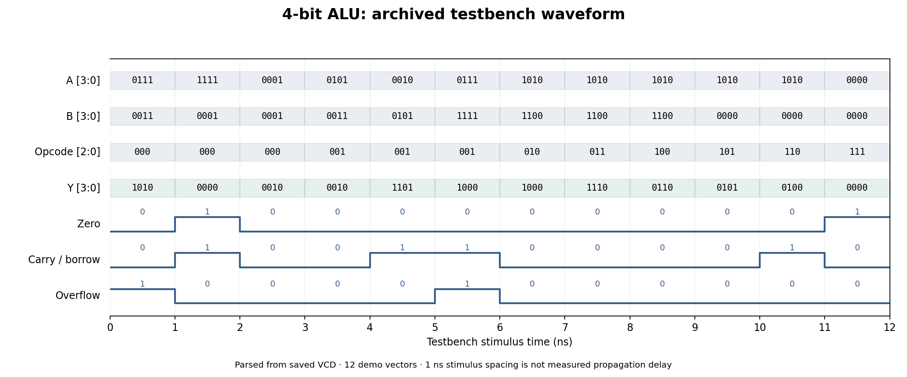

# 4-Bit Arithmetic Logic Unit in Verilog

A **combinational** 4-bit ALU with eight operations and three status flags. The repository contains RTL, a demonstration testbench, an exhaustive reference-model testbench, an example VCD trace and a waveform image.

**Status:** RTL functional simulation. No FPGA synthesis, timing characterization, or physical ALU construction is claimed.

## Operations

| Opcode | Function |
|:---:|---|
| `000` | A + B |
| `001` | A - B |
| `010` | A AND B |
| `011` | A OR B |
| `100` | A XOR B |
| `101` | NOT A |
| `110` | A << 1 |
| `111` | Pass B |

Outputs: `y[3:0]`, `zero`, `carry`, `overflow`. The **carry** flag indicates unsigned carry-out on addition, **borrow** (A < B) on subtraction, and the discarded high bit on left shift. **Overflow** indicates signed two's-complement overflow for addition/subtraction. For other operations, the latter flags are cleared unless otherwise stated.

## Simulate

Requires [Icarus Verilog](https://steveicarus.github.io/iverilog/usage/getting_started.html) (`iverilog` and `vvp`). Run from this folder:

```bash
# 12 demonstration vectors; generates alu4.vcd in the current directory
iverilog -g2012 -Wall -s tb_alu4 -o alu_sim alu4.v tb_alu4.v
vvp alu_sim

# 16 x 16 operand pairs x 8 opcodes = 2,048 cases
iverilog -g2012 -Wall -s tb_alu4_exhaustive -o alu_exhaustive alu4.v tb_alu4_exhaustive.v
vvp alu_exhaustive
```

Optional: open the generated `alu4.vcd` in GTKWave. A sample output VCD is saved at [`results/alu4_demo.vcd`](results/alu4_demo.vcd). To recreate the supplied image from that trace, run `python3 scripts/plot_waveform.py` (requires Matplotlib).

## Recorded waveform



## Verification evidence

The uploaded starter pack includes [`results/demo_output.txt`](results/demo_output.txt) and [`results/exhaustive_output.txt`](results/exhaustive_output.txt), reporting 12 demo checks and 2,048 exhaustive binary cases passed in an earlier Icarus Verilog run (12 November 2026). **These saved logs were preserved; the ALU was not re-executed during GitHub packaging because Icarus Verilog was unavailable.** You can rerun both testbenches using the commands above.

## Scope and limitations

The testbenches exercise binary inputs; they are not analog or gate-level timing measurements. The waveform's 1 ns intervals are *testbench stimulus spacing*, not the measured propagation delay of an ALU circuit. Synthesis area, maximum clock frequency and FPGA operation are outside this version.

For examples of sign extension, carry vs overflow, and the design's flag conventions, see [`docs/technical-walkthrough.md`](docs/technical-walkthrough.md).
